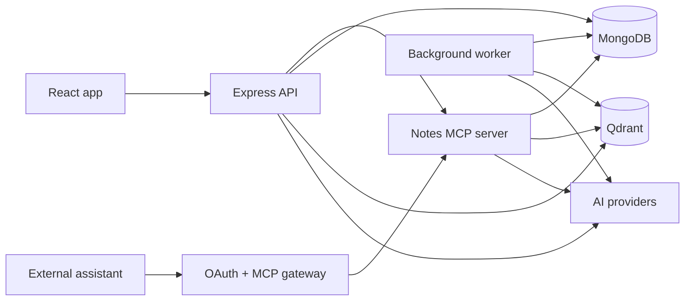

# Cortex

A personal knowledge app that turns notes into a searchable memory for AI assistants. Capture and organize notes, ask questions with citations back to their source, and connect external assistants through the Model Context Protocol (MCP).

[Architecture](docs/architecture.md) · [Local setup](docs/local_development.md) · [Module documentation](docs/README.md) · [AWS deployment](deploy/aws.md)

## What it does

- **Notes:** Markdown editing and preview, folders, tags, pinning, archiving, and search.
- **Chat with your notes:** semantic retrieval, streamed answers, conversation history, and citations that link back to the retrieved note chunks. Start a conversation from an open note to include its contents as context.
- **Voice capture:** a browser voice session through OpenAI Realtime, with notes available as MCP tools.
- **External assistants:** an OAuth authorization server and a public MCP gateway with per-user grants, read/write scopes, consent, and revocation.
- **OneNote import:** connect a Microsoft account, select notebooks, and synchronize notes through background jobs.
- **Account management:** email verification, password reset, rotating refresh sessions, and optional Google sign-in.

## How it is built

TypeScript throughout: React and Vite in the browser; Express on Node.js; MongoDB for application data; Qdrant for vector search; OpenAI for embeddings, agents, and voice. The single-shot AI service also supports an optional Anthropic adapter.



Some decisions worth exploring in the code:

- **Separate HTTP, business, integration, and storage layers.** Controllers call service interfaces; adapters wrap provider SDKs; repositories own persistence.
- **One notes tool surface.** Chat agents, voice, and external assistants reach the notes MCP server. The public gateway verifies OAuth access tokens and forwards a signed caller assertion.
- **Verified citation identifiers.** Citation markers are matched against the chunks retrieved during that turn before they become source links. Answer quality still depends on the model and retrieval results.
- **Durable background work.** MongoDB jobs use atomic claiming, leases, retries, and checkpoints so work can resume after a worker stops.
- **User-scoped retrieval.** Note queries and vector searches carry the authenticated user's identity across the API and MCP boundary.

See [architecture.md](docs/architecture.md) for the full request flows and known limitations, and [patterns.md](docs/patterns.md) for the implementation conventions.

## Run locally

Prerequisites: **Node.js 22.12 or later in the 22.x line**, npm, Docker with Compose, and an OpenAI API key for AI features. Provider calls use your own account and may incur charges.

```bash
git clone https://github.com/vsinghania/cortex.git
cd cortex
nvm use                       # or install Node.js 22 using your preferred manager
npm ci
npm --prefix web ci
cp .env.example .env
```

Set `OPENAI_API_KEY` in `.env` and generate independent random values for `JWT_ACCESS_SECRET`, `MCP_NOTES_AUTH_TOKEN`, and `MCP_GATEWAY_ASSERTION_SECRET`. The [local setup guide](docs/local_development.md) includes the commands and a sample chat-agent seed for a fresh database.

```bash
docker compose up -d mongodb qdrant mailpit
```

Seed the chat agent as described in the guide, then run each process in its own terminal:

```bash
npm run mcp:notes:dev          # notes tools on :3010
npm run worker:dev             # queued jobs, including verification emails
npm run dev                    # API on :3000
npm --prefix web run dev       # app on :5173
```

Open [localhost:5173](http://localhost:5173), register, and open the verification email in [Mailpit](http://localhost:8025). Create a note, then ask the chat a question about it.

The local Compose configuration publishes ports on loopback only. For a container-based backend, alternative setup steps, and optional voice/OAuth/OneNote configuration, see [local_development.md](docs/local_development.md).

## Development checks

```bash
npm run typecheck
npm --prefix web run typecheck
npm --prefix web run build
npm test
```

CI runs these checks on pull requests. A separate workflow scans Git history for secrets, and Dependabot checks npm dependencies and GitHub Actions.

## Security and license

Keep credentials in ignored local configuration or your deployment's secret store. The committed `web/.env.*` files contain public API URLs that ship in the browser bundle; never put secrets in `VITE_*` variables.

See [SECURITY.md](SECURITY.md) for vulnerability reporting and [the publication checklist](docs/public_release.md) for GitHub settings and history review before changing repository visibility.

[ISC License](LICENSE) © 2026 Vishal Singhania.
